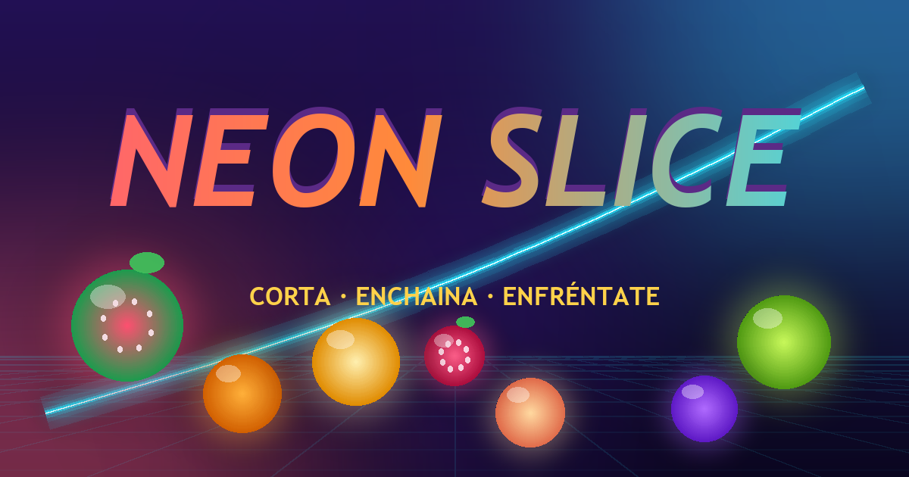

# NEON SLICE

Juego 2D de **cortar fruta** al estilo Fruit Ninja: desliza el ratón o el dedo para
trazar tu cuchilla neón, encadena cortes para multiplicar la puntuación y esquiva las bombas.

Todo el juego vive en un único archivo (`index.html`): sin dependencias, sin build step,
sin frameworks. Solo HTML + CSS + Canvas 2D + WebAudio.



## Jugar

```sh
python -m http.server 8123 --directory .
# abre http://localhost:8123
```

O simplemente abre `index.html` en el navegador (funciona también con `file://`).

## Qué hay dentro

| Mecánica | Detalle |
|---|---|
| **Cuchilla neón** | Estela con degradado, brillo y desvanecido en 420 ms. |
| **Racha ×5** | Cortes seguidos en menos de 1,15 s multiplican los puntos (10 × racha, tope ×5). |
| **Combo** | Varias frutas en un solo trazo: bonus de 25 puntos por cada una de más. |
| **Frenesí** | La fruta dorada activa 8 s de **puntos x2** y la pantalla se vuelve arcoíris. |
| **Bombas** | 3 vidas. Cortar una bomba quita vida, rompe la racha, congela la partida 90 ms y sacude la cámara. |
| **6 frutas + dorada** | Sandía, naranja, lima, ciruela, melocotón y fresa, cada una dibujada con degradados, pepitas y hoja. |
| **Dificultad progresiva** | Las oleadas se aceleran y aparecen más bombas según avanza la ronda (hasta el 30 %). |
| **75 segundos** | Medallas por puntuación: bronce 1.200, plata 4.000, oro 10.000. |
| **Récord** | Se guarda en `localStorage` (`neonslice.best.v1`) y se puede borrar desde la pantalla de fin. |
| **Sonido** | Sintetizado con WebAudio: corte, explosión, nota ascendente por racha y música chiptune de fondo. Tecla `M` para silenciar; el estado de silencio también se guarda. |

## Detalles técnicos

- Las frutas **se lanzan desde abajo** (950–1320 px/s) y luego caen por gravedad (1500 px/s²),
  describiendo un arco. Cada oleada sale en abanico desde el borde inferior.
- Resolución virtual fija de **960×600** con escalado y letterbox: se adapta a cualquier
  pantalla sin deformar la partida.
- Bucle de **paso fijo a 120 Hz** con acumulador, y `requestAnimationFrame` para dibujar.
- Sacudida de cámara, destello a pantalla completa, `hitstop` al cortar una bomba y
  salpicaduras de jugo que se desvanecen en el fondo.
- Partículas, estelas y efectos dibujados con composición aditiva (`lighter`).
- El HUD se refresca a ~10 Hz comparando el valor formateado (evita pelearse con el CSS).
- Cada ronda tiene un **token** (`S.round`): los temporizadores de muerte comprueban
  que la ronda no haya cambiado, de modo que reiniciar durante la explosión no mata la
  partida nueva.
- En móvil se pide orientación horizontal: al pasar a vertical la partida **se pausa**
  (no solo se tapa con un overlay).

## Accesibilidad

- Todos los controles son `<button type="button">` reales: se pueden tabular y activar con
  `ENTER` o `ESPACIO` (el atajo global no se come esas teclas cuando hay un control enfocado).
- Foco visible (`:focus-visible`) y foco automático en el botón principal de cada pantalla.
- El HUD está oculto para lectores de pantalla cuando no toca (`visibility`), y puntuación,
  tiempo, vidas y racha se anuncian con `aria-live="polite"`.
- Las pantallas de pausa y de fin son diálogos (`role="dialog"`, `aria-modal="true"`).
- Botón de silencio accesible por teclado (`aria-label` + `aria-pressed`).
- Sin `user-scalable=no`: el zoom del navegador funciona (WCAG 1.4.4).

## Atajos

| Tecla | Acción |
|---|---|
| `ESPACIO` / `ENTER` | Jugar o continuar |
| `P` / `ESC` | Pausa |
| `R` | Reiniciar |
| `M` | Silenciar |

Para depurar desde la consola del navegador: `NeonSlice.state` (puntuación, racha, vidas),
`NeonSlice.tick(dt)` (avanza la simulación), `NeonSlice.spawn('bomb', x, y)` y `NeonSlice.end()`.

## Estructura

```
index.html            el juego completo (HTML + CSS + JS en un solo archivo)
img/og.png            imagen Open Graph 1200×630
tools/check-inline-js.mjs   valida la sintaxis de los <script> inline (sin dependencias)
tools/make-og.py      regenera img/og.png (requiere Pillow: pip install pillow)
.github/workflows/ci.yml     CI: sintaxis JS + HTML
vercel.json           cabeceras de seguridad para Vercel
```

## Desarrollo y CI

```sh
node tools/check-inline-js.mjs .   # sintaxis de los scripts inline del HTML
```

El CI de GitHub Actions valida la sintaxis de los `.js`/`.mjs` y de los scripts inline del
HTML, y pasa `html-validate` de forma informativa (no rompe el build).

## Despliegue

**El juego todavía no está desplegado en ningún sitio.** La configuración queda lista:

- `vercel.json` con las cabeceras de seguridad (HSTS, `X-Frame-Options`, `Permissions-Policy`,
  `X-Content-Type-Options`, `Referrer-Policy`) y la caché de los ficheros estáticos.
- `index.html` lleva metadatos, Open Graph/Twitter y favicon en línea.

Para publicarlo, por ejemplo en Vercel:

```sh
deno run -A npm:vercel@latest deploy --prod --yes
```

Y actualiza `link rel="canonical"`, `og:url` y `og:image` con el dominio real antes de
publicarlo (ahora apuntan a `https://byilias29-max.github.io/neon-slice/`).

## Licencia

MIT — ver [LICENSE](LICENSE).
